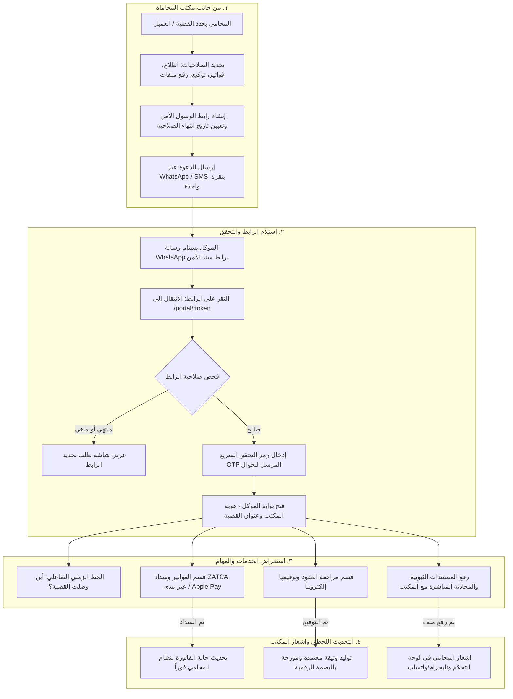

# سند (Sanad) — خارطة طريق المنتج ومسار تجربة بوابة العميل
## Product Roadmap & Client Portal UX Specification

> **الإصدار:** 1.0.0  
> **التاريخ:** أكتوبر 2026  
> **الحالة:** معتمد للتنفيذ (Approved for Execution)  
> **النطاق:** رحلة الفئات الأربع (الزائر، المحامي، المتدرب/الطالب، الموكل) مع تفصيل بوابة العميل

---

## ١. مصفوفة رحلة الفئات المستهدفة (Persona Journey Matrix)

| الفئة المستهدفة | لحظة الوصول (Arrival) | التفعيل والتهيئة (Onboarding) | القيمة اليومية المتكررة (Daily Value) | الاستبقاء والتوسع (Retention & Expansion) |
|---|---|---|---|---|
| **١. الزائر (Visitor)** | صفحة هبوط ذات تحويل عالي، معاينة اجتماعية (OG tags)، مقالات الأنظمة العامة (SEO) | بيئة تجريبية تفاعلية بضغطة زر (Sandbox Demo) مع بيانات حية وهمية | تصفح النشرة القانونية ومحاكي التكاليف القضائية | الاطلاع على صفحة الباقات والأسعار والترقية لمكتب تجريبي |
| **٢. المحامي (Lawyer)** | تسجيل سلس، استيراد بيانات من إكسل، اختيار تخصص المكتب | معالج التهيئة الذكي (Onboarding Wizard): إضافة موظف، إنشاء أول موكل وقضية | الموجز الصباحي (Morning Briefing)، تنبيهات المدد والمهل النظامية عبر WhatsApp | تقارير الشركاء الشهرية (PDF)، دعوة الموكلين عبر البوابة الذكية |
| **٣. الطالب / المتدرب (Student)** | التسجيل بالبريد الجامعي (`.edu.sa`) للحصول على حساب مجاني معتمد | اختبار تحديد المستوى، اختيار المسار التعليمي (صياغة / مرافعات) | بنك المصطلحات، التكرار المتباعد للبطاقات، مصحح العقود بالذكاء الاصطناعي | شهادات إتمام معتمدة، ملف المتدرب الجاهز للتوظيف للمكاتب المسجلة |
| **٤. الموكل (Client)** | استلام رابط سحري آمن عبر WhatsApp / SMS بدون كلمات مرور | التحقق السريع برمز لمرة واحدة (OTP) وشاشة ترحيب مخصصة باسم المكتب | خط زمني مبسط للقضية بلغة واضحة خالية من التعقيد القانوني | دفع فواتير ZATCA مباشرة، اعتماد وتوقيع المذكرات إلكترونياً |

---

## ٢. خارطة طريق المنتج التفصيلية (Product Roadmap)

### 📌 المرحلة الأولى: تعزيز التحويل وتأمين قيمة المحامي الأساسية (Sprint 1 - 2)

#### الملحمة ١: بوابة الزائر والتحويل السريع (Visitor Conversion & Transparency)
- **US-VIS-01: صفحة الأسعار والباقات الشفافة (`/pricing`)**
  - **الوصف:** كزائر، أريد رؤية باقات واضحة ومحددة تناسب المحامي الفرد، المكاتب المتوسطة، والطلاب مع تفاصيل المزايا المحلية.
  - **معايير القبول (Acceptance Criteria):**
    - [x] إتاحة 3 باقات رئيسية: (ممارس فردي، مكتب محاماة، باقة طالب مجانية).
    - [x] مفتاح تحويل سنوي/شهري مع إبراز نسبة التوفير (20%).
    - [x] جدول مقارنة تفصيلي يشمل: الذكاء الاصطناعي السيادي، عدد الموكلين، ربط ZATCA، وتطبيق PWA.
    - [x] زر دعوة لاتخاذ إجراء (CTA) مباشر لكل باقة ينقل للتسجيل مع تمرير معرّف الباقة تلقائياً.

- **US-VIS-02: البيئة التجريبية التفاعلية الفورية (Self-Serve Sandbox)**
  - **الوصف:** كزائر أو مشتري محتمل، أريد تجربة النظام ببيانات سعودية افتراضية جاهزة (مكتب نموذج) دون الحاجة لطلب إذن أو إدخال بطاقة ائتمانية.
  - **معايير القبول:**
    - [x] زر "جرّب مكتب تجريبي فوري" في شريط التنقل الرئيسي.
    - [x] إنشاء جلسة تجريبية معزولة (Ephemeral Workspace) تحوي 3 قضايا، عقدين، وفاتورتين افتراضية.
    - [x] شريط إرشادي علوي يوضح حالة العرض التوضيحي مع زر "أنشئ مكتبك الحقيقي الآن".
    - [x] تنظيف الجلسات المؤقتة تلقائياً بعد مرور ساعتين.

- **US-VIS-03: المعاينة الاجتماعية (OpenGraph & Twitter Cards) وتحسين محركات البحث**
  - **الوصف:** كفريق تسويق ومستخدم يشارك الروابط، أريد ظهور بطاقات معاينة عربية جذابة عند مشاركة روابط سند على WhatsApp و X و LinkedIn.
  - **معايير القبول:**
    - [x] توفير وسوم `og:title`, `og:description`, `og:image`, `twitter:card` لكافة الصفحات العامة.
    - [x] توليد صور معاينة ديناميكية بدقة (1200x630) تحمل هوية سند وخلاصة الصفحة المحددة.
    - [x] فتح النشرة القانونية للعامة مع فهرسة الكلمات المفتاحية المتعلقة بالأنظمة واللوائح السعودية.

---

#### الملحمة ٢: التفعيل اليومي للمحامي وتنبيهات المخاطر (Lawyer Onboarding & Daily Loop)
- **US-LAW-01: معالج الإعداد الذكي للمكتب (Smart Onboarding Wizard)**
  - **الوصف:** كمحامٍ جديد سجل في سند، أريد مرشداً خطوة بخطوة يملأ بيانات مكتبي ويرشدني لإنشاء أول عميل وقضية لتفادي الشاشات الفارغة.
  - **معايير القبول:**
    - [x] معالج تفاعلي مكون من 4 خطوات: (بيانات المكتب وترخيص العدل → دعوة الزملاء/المتدربين → إضافة العميل الأول → استيراد أو إنشاء أول قضية/عقد).
    - [x] توفير خيار "استيراد ملف تجريبي" للمشاهدة السريعة.
    - [x] شريط تقدم مرئي مع إمكانية استئناف الإعداد لاحقاً.

- **US-LAW-02: شاشة الموجز الصباحي والتنبيهات الحرجة (Morning Briefing & Deadline Radar)**
  - **الوصف:** كمحامٍ، عند فتح التطبيق صباحاً، أريد شاشة موحدة تلخص التزامات اليوم والمواعيد النظامية الوشيكة مع إشعارات مباشرة.
  - **معايير القبول:**
    - [x] بطاقة علوية تعرض: جلسات اليوم، مدد الاعتراض القضائية المتبقية، وانتهاء سريان إقامات أو وكالات الموكلين.
    - [x] تكامل الإشعارات عبر رسائل WhatsApp / SMS للمدد الحرجة (أقل من 48 ساعة على فوات ميعاد استئناف أو جلسة).
    - [x] إجراءات سريعة بضغطة زر: (تأجيل، إتمام، فتح رابط الجلسة بناجز، إشعار الموكل).

- **US-LAW-03: تقرير إنجاز الشركاء الشهري المعتمد (Firm Executive PDF Report)**
  - **الوصف:** كشريك أو مدير مكتب، أريد توليد تقرير تنفيذي منسق بنقرة واحدة لتلخيص ساعات العمل، الفواتير المحصلة، والقضايا الرابحة لمشاركته مع الشركاء.
  - **معايير القبول:**
    - [x] تصدير تقرير PDF أنيق باللغة العربية متوافق مع معايير الطباعة A4.
    - [x] يتضمن ملخص العمليات، نسب الإنجاز، مؤشرات الامتثال، وحصاد الفوترة الإلكترونية ZATCA.
    - [x] وضع علامة مائية وشعار المكتب المخصص.

---

### 📌 المرحلة الثانية: بناء بوابة العميل السيادية (Sprint 3 - 4) — *الخطوة الميدانية القادمة*

#### الملحمة ٣: بوابة الموكل الخفيفة وفائقة الأمان (Client Sovereign Portal)
- **US-CLI-01: وصول فوري بدون كلمات مرور (Magic Link & WhatsApp Delivery)**
  - **الوصف:** كموكل، أريد فتح ملف قضيتي عبر رابط مرسل لهاتفي دون الاضطرار لإنشاء حساب أو تذكر كلمات مرور معقدة.
  - **معايير القبول:**
    - [x] توليد رابط آمن ذو توكن مشفر برمز HMAC-SHA256 مع فترة صلاحية محددة.
    - [x] إرسال الرابط آلياً عبر WhatsApp و SMS فور تفعيله من قبل المحامي.
    - [x] التحقق الإضافي برمز لمرة واحدة (OTP مكون من 4 أرقام) يُرسل لنفس رقم الهاتف المسجل.
    - [x] إمكانية إلغاء الرابط فوراً من طرف المحامي في أي وقت بنقرة زر.

- **US-CLI-02: الخط الزمني المبسط للقضية (Plain-Arabic Case Timeline)**
  - **الوصف:** كموكل، أريد معرفة أين وصلت قضيتي، وما هو المطلوب مني الآن، وما هي الخطوة التالية بلغة بسيطة ومفهومة.
  - **معايير القبول:**
    - [x] خط زمني تفاعلي يترجم المراحل القضائية المعقدة إلى 4 حالات واضحة (تم استلام الطلب → إعداد اللائحة → مرحلة الترافع والجلسات → صدور الحكم والتنفيذ).
    - [x] إبراز صندوق الإجراء المطلوب ("مطلوب منك: تزويدنا بصورة الحوالة البنكية قبل يوم الخميس").
    - [x] بطاقة تفاصيل الجلسة القادمة مع توقيت العد التنازلي.

- **US-CLI-03: مراجعة واعتماد الفواتير الإلكترونية ZATCA والسداد الفوري**
  - **الوصف:** كموكل، أريد استعراض الفاتورة الضريبية المبسطة المعتمدة مع رمز الاستجابة السريع (ZATCA QR) وسدادها مباشرة.
  - **معايير القبول:**
    - [x] عرض الفاتورة الضريبية بصيغة نظامية مع قراءة تفصيلية للأتعاب والضريبة (15%).
    - [x] زر تحميل الفاتورة بصيغة PDF معتمدة ومطابقة لمتطلبات هيئة الزكاة والضريبة والجمارك.
    - [x] زر دفع إلكتروني يدعم (مدى، Apple Pay، وسداد) مع تحديث حالة الفاتورة في نظام المحامي فوراً.

- **US-CLI-04: مراجعة العقود والتوقيع الإلكتروني المعتمد (Document E-Approval & E-Sign)**
  - **الوصف:** كموكل، أريد مراجعة مسودة العقد أو المذكرة التي أعدها المحامي، وإضافة ملاحظات أو الموافقة وتوقيعها إلكترونياً.
  - **معايير القبول:**
    - [x] عارض مستندات آمن مخصص للجوال مع إمكانية التكبير والتنقل بين الصفحات.
    - [x] إمكانية إضافة تعليق موجه للمحامي حول بند محدد.
    - [x] منصة توقيع إلكتروني باللمس أو برمز التحقق عبر الجوال مع تسجيل البصمة الزمنية وعنوان IP للامتثال لنظام التعاملات الإلكترونية السعودي.
    - [x] إشعار فوري للمحامي فور اعتماد أو توقيع العقد.

---

### 📌 المرحلة الثالثة: مسارات الطلاب والتدريب المهني (Sprint 5 - 6)

#### الملحمة ٤: تأهيل المتدربين وبنك الكفاءات القانونية (Student Mastery & Talent Bridge)
- **US-STU-01: التوثيق الجامعي والمسارات التخصصية التفاعلية**
  - **الوصف:** كطالب قانون، أريد التسجيل مجاناً ببريدي الجامعي ودراسة مسارات عملية (صياغة العقود التجارية، إجراءات المحاكم العمالية).
  - **معايير القبول:**
    - [x] التحقق التلقائي من النطاقات الجامعية السعودية (`*.edu.sa`).
    - [x] مسارات تعليمية بمقاييس إنجاز واضحة، كل مسار يحوي وحدات تطبيقية واختبارات قصيرة.
    - [x] إصدار شهادة إتمام إلكترونية قابلة للتحقق عبر QR code.

- **US-STU-02: المصحح الذكي لصياغة العقود (AI Practice Grader)**
  - **الوصف:** كمتدرب، أريد كتابة مسودة عقد وتلقي تقييم فوري من الذكاء الاصطناعي بناءً على أحكام نظام المعاملات المدنية ونظام العمل السعودي.
  - **معايير القبول:**
    - [x] توفير محرر نصوص مع إمكانية فحص بنود العقد بضغطة زر.
    - [x] إعطاء درجة امتثال من 100 مع تسليط الضوء على الثغرات النظامية واقتراح الصياغة السليمة.
    - [x] العمل بنموذج الذكاء الاصطناعي المحلي (Qwen 2.5 14B) لضمان الخصوصية والسرعة.

- **US-STU-03: التكرار المتباعد للمصطلحات والأنظمة (Spaced Repetition Flashcards)**
  - **الوصف:** كطالب يستعد لاختبار رخصة المحاماة، أريد مراجعة بنك الأسئلة والأنظمة بنظام ذكي يعيد تكرار الأسئلة الصعبة قبل نسيانها.
  - **معايير القبول:**
    - [x] خوارزمية تكرار متباعد (مبنية على منهجية SuperMemo SM-2).
    - [x] إحصائيات يومية لعدد البطاقات المتقنة والبطاقات المستحقة للمراجعة.
    - [x] دعم العمل دون اتصال بالإنترنت عبر PWA.

- **US-STU-04: جسر التوظيف والتدريب التعاوني (Trainee Talent Marketplace)**
  - **الوصف:** كطالب متميز أو متدرب، أريد عرض ملفي وإنجازاتي التدريبية أمام مكاتب المحاماة المشتركة في سند للتقديم على فرص التدريب.
  - **معايير القبول:**
    - [x] ملف إنجاز موحد للمتدرب يعرض درجات الاختبارات العملية وسجل العقود المصاغة.
    - [x] لوحة تصفح للمكاتب مع مرشحات للبحث حسب المدينة والتخصص والمعدل التقييمي.
    - [x] قناة تواصل مباشرة بين صاحب المكتب والمتدرب مع حفظ الخصوصية.

---

## ٣. المواصفة الفنية التفصيلية لتجربة بوابة العميل (Client Portal UX Specification)

### ٣.١ مخطط تدفق رحلة الموكل (Client Journey Flow Diagram)



---

### ٣.٢ تفصيل الشاشات وواجهة المستخدم (Screen-by-Screen UX Specifications)

#### الشاشة الأولى: شاشة التحقق الآمن (Secure Entry & OTP Verification)
- **الهدف:** توفير أقصى درجات الأمان دون أي كلمة مرور مع الامتثال لنظام حماية البيانات الشخصية السعودي (PDPL).
- **العناصر البصرية:**
  - شعار مكتب المحاماة المخصص يعلوه وسم "سند للأمان القانوني".
  - نص ترحيبي: "مرحباً بك في البوابة الرقمية لمتابعة ملفك لدى [اسم مكتب المحاماة]".
  - حقل إدخال رمز الأمان (OTP) المكون من 4 خانات بأرقام كبيرة وسهلة الاستخدام باللمس.
  - زر "إعادة إرسال الرمز عبر WhatsApp" بعد انتهاء عداد 60 ثانية.
  - شارة أمان تؤكد تشفير الجلسة بتقنية TLS ومطابقتها للمتطلبات السيادية.

#### الشاشة الثانية: اللوحة الرئيسية للموكل (Client Mobile-First Dashboard)
- **الترتيب البصري (من الأعلى للأسفل):**
  1. **شريط الهوية والاتصال السريع:** شعار المكتب + زر الاتصال المباشر بالمحامي المسؤول عبر الهاتف أو WhatsApp.
  2. **بطاقة الإجراء العاجل (Action Required Banner):** تظهر فقط عند وجود التزام على الموكل (مثال: "مطلوب موافقتك على مسودة اللائحة قبل يوم الأحد").
  3. **بطاقة حالة القضية الذكية (Plain-Arabic Status):**
     - العنوان: قضية مطالبة مالية - المحكمة التجارية بالرياض.
     - الحالة الحالية: **"تم تبادل المذكرات، بانتظار موعد الجلسة القضائية"**.
     - موعد الجلسة القادمة: **الأربعاء، ١٤ ربيع الآخر ١٤٤٨هـ (باقي ٥ أيام)** مع زر إضافة للتقويم.
  4. **شريط التبويبات السفلي أو القوائم السريعة:**
     - 📜 **المسار الزمني (Timeline)**
     - 💳 **الفواتير والمدفوعات (Invoices)**
     - ✍️ **المستندات والتواقيع (Documents)**
     - 📁 **الملفات المرفوعة (Shared Files)**

#### الشاشة الثالثة: مسار الخط الزمني القضائي (Visual Case Journey)
- خط رأسي تفاعلي يمثل رحلة القضية من البداية حتى الحكم:
  - 🟢 **المرحلة ١: استلام المستندات وصياغة صحيفة الدعوى** (مكتملة - 10 سبتمبر).
  - 🟢 **المرحلة ٢: قيد الدعوى في منصة ناجز وحجز الموعد** (مكتملة - 18 سبتمبر).
  - 🔵 **المرحلة ٣: الجلسة التحضيرية الأولى وتبادل الدفوع** (جارية الآن - تاريخ الجلسة القادمة 15 أكتوبر).
  - ⚪ **المرحلة ٤: المرافعة الختامية والنطق بالحكم** (مستقبلية).
  - ⚪ **المرحلة ٥: التنفيذ واستحصال الحق** (مستقبلية).
- عند النقر على أي مرحلة مكتملة، تظهر نبذة بسيطة كتبها المحامي بأسلوب موجز يطمئن الموكل.

#### الشاشة الرابعة: الفواتير والسداد الإلكتروني (ZATCA Invoices & Instant Checkout)
- قائمة الفواتير المستحقة مع وسم الحالة (مستحقة / مسددة / قيد المعالجة).
- معاينة الفاتورة:
  - تفاصيل الأتعاب، رسوم المحكمة (إن وجدت)، وضريبة القيمة المضافة 15%.
  - باركود ZATCA المشفر المتوافق مع المرحلة الثانية للربط والتكامل.
- طرق السداد المدعومة:
  - أزرار دفع بنقرة واحدة: **Apple Pay**، بطاقات **مدى** البنكية، ونظام **سداد**.
  - فور تأكيد العملية يتم تحويل الحالة تلقائياً إلى "مسددة" وإرسال إشعار للمحاسب في لوحة تحكم سند.

#### الشاشة الخامسة: مراجعة المستندات والتوقيع الإلكتروني (E-Signature & Approval)
- عارض متجاوب لقراءة ملفات PDF والمذكرات المصاغة.
- إمكانية تمييز النصوص وإضافة ملاحظة سريعة في حال كان للموكل تعقيب.
- في نهاية المستند يظهر زر "اعتماد وتوقيع المستند":
  - يفتح لوحة توقيع إلكترونية تعمل باللمس أو القلم.
  - تتضمن إقراراً نظامياً بالاطلاع والموافقة.
  - يتم تضمين: البصمة الرقمية للوثيقة (SHA-256 Hash)، عنوان IP، التوقيت المحلي الدقيق (UTC+3)، ورقم الهاتف الموثق بالـ OTP لضمان الحجية النظامية.

---

### ٣.٣ التعديلات المطلوبة على بنية قاعدة البيانات (Prisma Schema Delta)

لتدعيم هذا المسار المتطور، سيتم توسيع نموذج `PortalAccess` الحالي بإضافة الجداول والعلاقات التالية:

```prisma
// نموذج جلسات الدخول والتحقق الآمن برمز لمرة واحدة
model PortalOtp {
  id             String    @id @default(cuid())
  portalAccessId String
  phone          String
  codeHash       String
  expiresAt      DateTime
  attempts       Int       @default(0)
  verifiedAt     DateTime?
  createdAt      DateTime  @default(now())

  portalAccess   PortalAccess @relation(fields: [portalAccessId], references: [id], onDelete: Cascade)
  @@index([portalAccessId])
  @@index([expiresAt])
}

// نموذج التوقيعات والاعتمادات الإلكترونية للمستندات
model PortalSignature {
  id             String    @id @default(cuid())
  portalAccessId String
  documentId     String
  signerName     String
  signerPhone    String
  signatureSvg   String    // مسار التوقيع كمتجه رقمي
  documentHash   String    // SHA-256 للوثيقة وقت التوقيع
  ipAddress      String?
  userAgent      String?
  signedAt       DateTime  @default(now())

  portalAccess   PortalAccess  @relation(fields: [portalAccessId], references: [id], onDelete: Cascade)
  document       LegalDocument @relation(fields: [documentId], references: [id], onDelete: Cascade)
  @@index([portalAccessId])
  @@index([documentId])
}

// نموذج جلسات الدفع الإلكتروني لبوابة الموكل
model PortalPaymentSession {
  id             String    @id @default(cuid())
  portalAccessId String
  invoiceId      String
  amount         Decimal
  currency       String    @default("SAR")
  gatewayRef     String?
  paymentMethod  String?   // mada | apple_pay | sadad | credit_card
  status         String    @default("pending") // pending | paid | failed
  paidAt         DateTime?
  createdAt      DateTime  @default(now())

  portalAccess   PortalAccess @relation(fields: [portalAccessId], references: [id], onDelete: Cascade)
  invoice        Invoice      @relation(fields: [invoiceId], references: [id], onDelete: Cascade)
  @@index([portalAccessId])
  @@index([invoiceId])
  @@index([status])
}
```

---

## ٤. خطة التنفيذ الميدانية القادمة (Next Immediate Build Steps)

1. **تحديث وتطوير صفحة بوابة العميل (`src/app/portal/[token]/page.tsx`):**
   - تحويل الواجهة الحالية البسيطة إلى التصميم التفاعلي الجذاب للهاتف الذكي.
   - إضافة مكون التبويبات المتجاوبة: (الجدول الزمني للقضية، الفواتير والسداد، المستندات والتوقيع).
2. **بناء مكون التوقيع الإلكتروني والاعتماد (`PortalDocumentSigner.tsx`):**
   - لوحة رسم توقيع باللمس (HTML5 Canvas).
   - توثيق البصمة الزمنية والبيانات الفنية.
3. **تكامل عرض الفاتورة ZATCA مع زر السداد السريع (`PortalInvoiceView.tsx`):**
   - استعراض رمز الـ QR والبيانات الضريبية بصيغة أنيقة ومتجاوبة.
4. **تحديث شاشة إدارة وصول العميل في لوحة تحكم المحامي (`src/components/sanad/CaseDetailDrawer.tsx`):**
   - إضافة زر "مشاركة رابط البوابة عبر WhatsApp" وزر "إعادة التوليد / الإلغاء الفوري".
